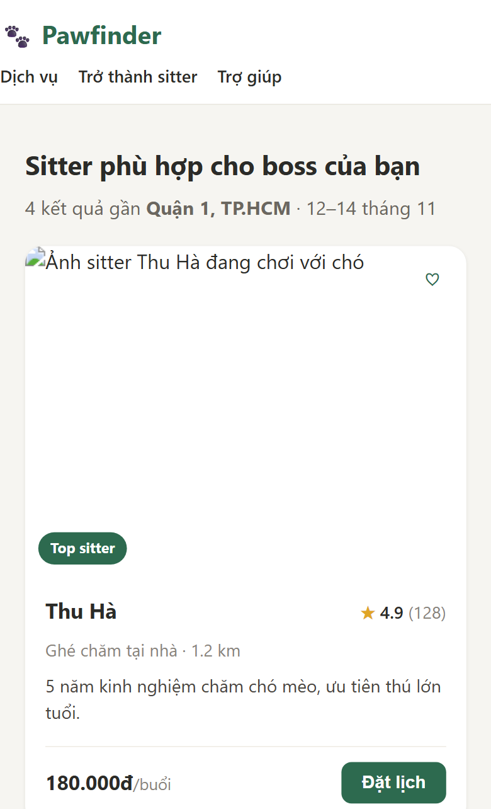
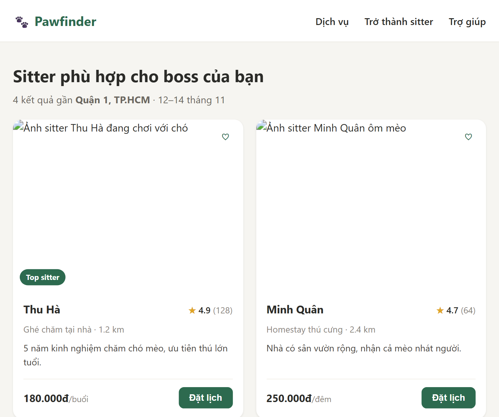
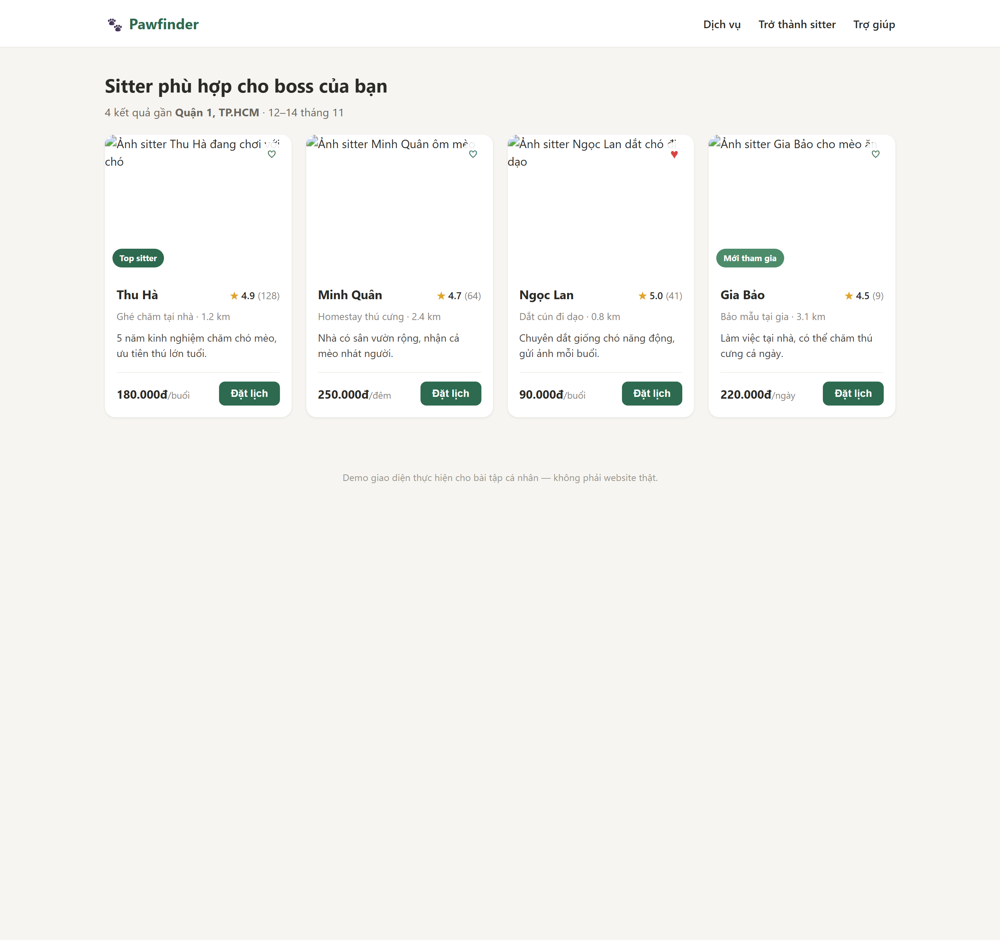
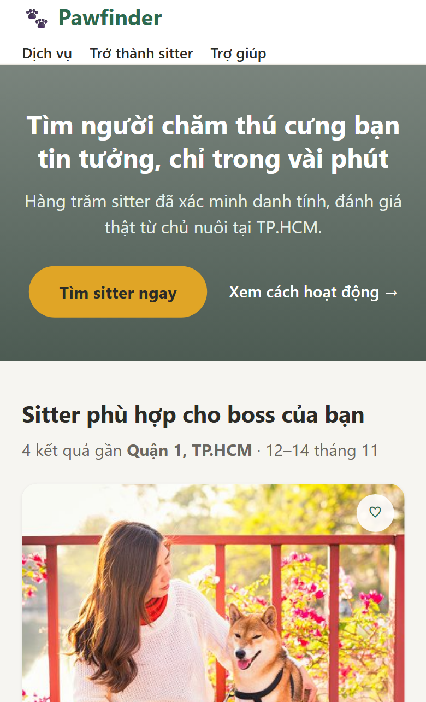
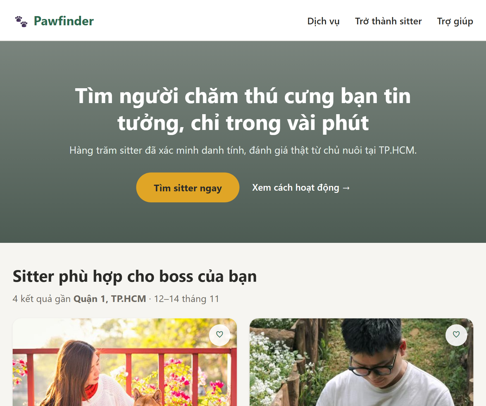
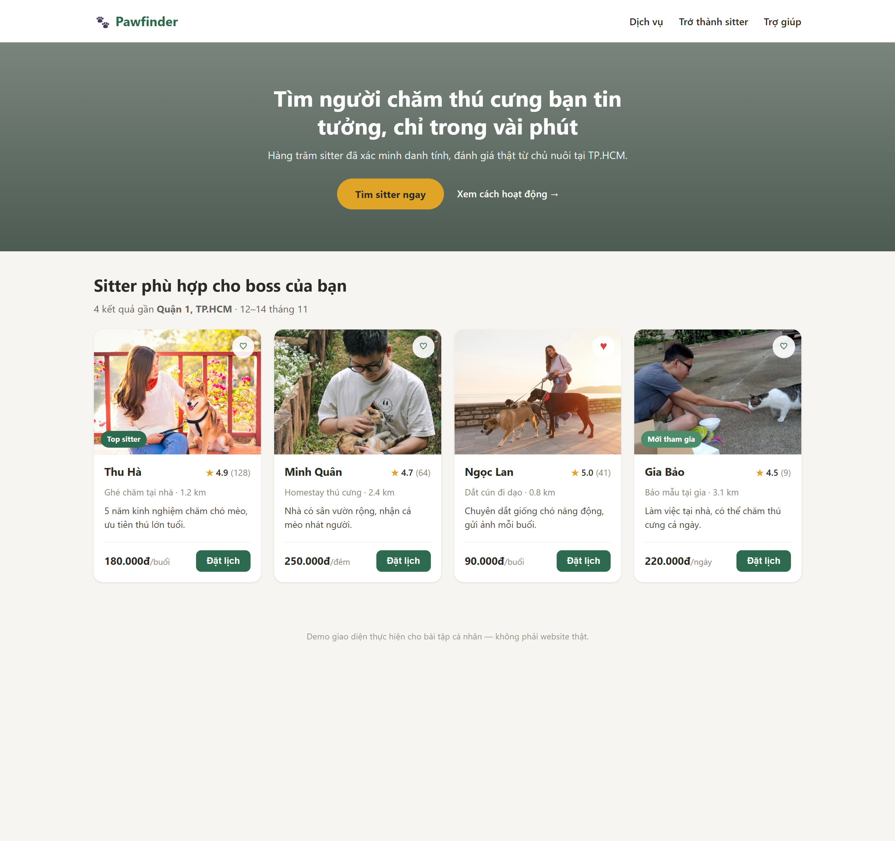

# Pet Sitter UI Improvement

## 1. Giới thiệu
Bài tập cá nhân (btcn) môn Phát triển ứng dụng WEB/TMĐT — khảo sát một website
thương mại điện tử thiên hướng dịch vụ chăm sóc thú cưng, dùng AI hỗ trợ phân
tích, và tự thiết kế lại một khu vực giao diện bằng HTML5/CSS3.

## 2. Website tham khảo
- Tên website: Rover
- URL: https://www.rover.com/
- Khu vực đã khảo sát và cải tiến: Danh sách/thẻ hiển thị người chăm thú cưng
  (sitter listing)

## 3. Chức năng
- Hiển thị danh sách sitter dạng thẻ lưới (card grid)
- Mỗi thẻ hiển thị: ảnh, tên, đánh giá (số sao + số lượt), khoảng cách, giá
  kèm đơn vị, nút "Đặt lịch", nút lưu yêu thích
- Bố cục responsive: 4 cột (desktop) → 2 cột (tablet) → 1 cột (mobile)

## 4. Công nghệ
- HTML5
- CSS3 (CSS Grid, Flexbox, Media Queries)

## 5. Cách chạy
Mở file `index.html` bằng trình duyệt (không cần máy chủ, không cần cài đặt
gì thêm).

## 6. Vấn đề quan sát được
Qua khảo sát thực tế trên rover.com (trang kết quả tìm kiếm House Sitting),
danh sách sitter hiển thị dạng hàng dài với độ dài nội dung không đều (đoạn
trích đánh giá dài ngắn khác nhau giữa các sitter), khiến khách hàng khó so
sánh nhanh giá, đánh giá và khoảng cách giữa nhiều sitter cùng lúc. Giá hiển
thị dạng "from $X" cũng chưa rõ ràng về tổng chi phí thực tế.

## 7. Cải tiến đã thực hiện
Thiết kế lại danh sách sitter thành dạng thẻ lưới (card grid) thay vì danh
sách hàng dài:
- Nhóm các thông tin quan trọng (ảnh, tên, giá, đánh giá) vào cùng một khung
  nhìn cố định trên mỗi thẻ, kích thước đồng đều, dễ quét mắt so sánh
- Giá hiển thị rõ đơn vị (`/đêm`, `/buổi`, `/ngày`) ngay cạnh số tiền
- Thêm huy hiệu nổi bật ("Top sitter", "Mới tham gia") giúp nhận diện nhanh
  sitter đáng tin mà không cần mở từng hồ sơ
- Thêm nút lưu yêu thích (♡/♥) ngay trên thẻ để so sánh nhiều sitter cùng lúc
- Bố cục responsive để hiển thị tốt trên điện thoại
- Đổi màu chủ đạo từ cam sang xanh biển rồi xanh lá đậm

## 8. Hỗ trợ từ AI
AI hỗ trợ phân tích giao diện gốc (Nhiệm vụ 2) và đề xuất phương án bố cục
thẻ lưới trước khi viết mã nguồn (Nhiệm vụ 3, bước 2). Toàn bộ quan sát được
đối chiếu lại với website thật và ảnh chụp màn hình thực tế trước khi đưa
vào báo cáo. Chi tiết prompt và quá trình kiểm tra xem tại `AI_USAGE.md`.

## 9. Buổi 2 – HTML5 và CSS3 cơ bản

### 9.1. Giới thiệu bài tập
Bài tập cá nhân Buổi 2 môn Phát triển ứng dụng WEB/TMĐT, tiếp tục phát triển giao diện đã làm ở Buổi 1. Bài chỉ dùng HTML5 và CSS3, không có JavaScript, backend hay cơ sở dữ liệu.

### 9.2. Website tham khảo và khu vực đã cải tiến
- Website tham khảo: Rover (https://www.rover.com/).
- Khu vực đã chọn: danh sách thẻ sitter, cùng khu vực banner và nút kêu gọi hành động ở đầu trang.

### 9.3. Vấn đề phát hiện ở Bước 1 (trước khi chỉnh sửa)
| # | Vấn đề | Hướng cải thiện |
|---|---|---|
| 1 | Ảnh sitter không hiển thị, chỉ thấy chữ alt (ảnh lấy từ link Unsplash bên ngoài bị hỏng) | Lưu ảnh trong thư mục `images/` của repo |
| 2 | Ở 390 px, logo và menu sát mép trái màn hình | Thêm khoảng đệm bên trái cho thanh header |
| 3 | Trang vào thẳng danh sách, chưa có banner hay lời kêu gọi hành động | Thêm khu vực banner với nút "Tìm sitter ngay" |

Ảnh trước khi chỉnh sửa:

### 9.4. Những kỹ thuật HTML5/CSS3 đã thực hành
- HTML5 ngữ nghĩa: `header`, `nav`, `main`, `section`, `article`, `footer`; thứ bậc tiêu đề `h1` (banner), `h2` (mục kết quả), `h3` (tên sitter); `img` kèm `alt`.
- CSS: liên kết tệp `css/style.css`, class selector và descendant selector, margin, padding, border, border-radius.
- Flexbox: header, menu, nhóm nút ở banner, phần chân thẻ (giá và nút "Đặt lịch").
- CSS Grid: lưới thẻ sitter 4 cột, `gap: 20px`, đổi còn 2 cột và 1 cột bằng media query; ảnh dùng `aspect-ratio` và `object-fit: cover`.
- Hover và focus: `:hover` kèm `transition`, `:focus-visible` cho liên kết và nút.

### 9.5. Những thay đổi đã thực hiện
- Thêm khu vực banner và nút kêu gọi hành động "Tìm sitter ngay".
- Thêm hiệu ứng hover (nút, liên kết menu, thẻ) và viền focus rõ khi dùng phím Tab.
- Thay ảnh sitter từ link ngoài sang ảnh trong `images/`, căn lại vùng cắt của ảnh sitter thứ hai bằng `object-position`.
- Sửa thứ bậc tiêu đề: trang chỉ còn một `h1`.
- Tự sửa một lỗi ở Bước 8: ở 390 px menu sát mép trái, đã thêm `padding-left: 12px` cho `.header-inner` trong khối media query.

Ảnh sau khi chỉnh sửa:

### 9.6. Bảng kiểm thử
| Nội dung kiểm tra | Kết quả | Ghi chú |
|---|---|---|
| Trang HTML mở được | Đạt | Mở `index.html` bằng trình duyệt |
| CSS được áp dụng | Đạt | `css/style.css` liên kết đúng |
| Hình ảnh hiển thị đúng | Đạt | Sau khi thay link Unsplash bằng ảnh trong `images/` |
| Liên kết hoạt động | Đạt một phần | Nút "Tìm sitter ngay" cuộn đúng tới danh sách; các liên kết menu dùng `#` vì chưa có trang đích |
| Bố cục không bị tràn nghiêm trọng | Đạt | Đã xem ở 1366, 768 và 390 px |
| Hover/focus hoạt động | Đạt | Kiểm tra bằng chuột và phím Tab |
| Đã tự sửa ít nhất một vấn đề | Đạt | Sửa lề menu ở 390 px, lỗi ảnh và thứ bậc tiêu đề |

### 9.7. Công cụ AI và cách kiểm tra
Dùng Claude để hướng dẫn cấu trúc HTML5, hiệu ứng hover/focus và kiểm tra lỗi giao diện. Mọi đề xuất đều được thử trên trình duyệt và đối chiếu với mã nguồn trước khi dùng; chi tiết prompt và phần tự điều chỉnh nằm ở mục 7 của `AI_USAGE.md`.

### 9.8. Nguồn ảnh
Bốn ảnh sitter (`images/sitter-1.jpg` đến `sitter-4.jpg`) được tìm trên internet, dùng cho mục đích học tập trong bài tập này. Tác giả và nguồn gốc cụ thể: [bổ sung nếu truy ra được].

### 9.9. Chạy website và repository
Mở `index.html` bằng trình duyệt, không cần cài đặt. Repository: https://github.com/Dat-906/ecommerce-ui-improvement-rover.com. Website chưa được triển khai trực tuyến.
